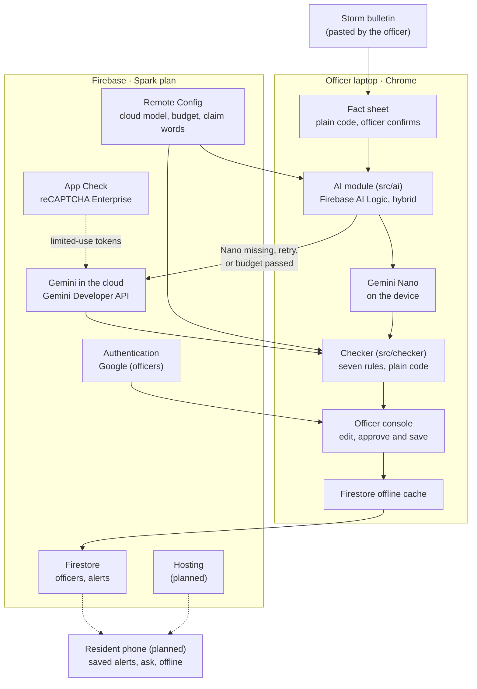

# Architecture

Babala turns an official storm bulletin into checked, plain-language typhoon alerts for each household, and keeps working when the signal drops. It is a static web app on Firebase with no server of its own, on the free Spark plan with no billing account.

A barangay officer's laptop drafts alerts with Gemini Nano on the device, through Firebase AI Logic. Plain code checks every figure against the bulletin, and the officer approves. The cloud model drafts when Nano is missing or fails. It will also translate approved alerts while the connection is up. Residents' phones will save the alerts and answer questions on the device, in the cloud, or with plain text search when neither is available.

The SDK falls back to the cloud only when the local model is missing. Babala also catches a **bad** answer, with a code checker that no model can talk its way past.

Dashed lines are planned. `src/ai/` is the only module that imports `firebase/ai`, and `src/checker/` imports no Firebase, AI or UI code.

## How one alert flows

1. **Sign in.** The officer signs in with Google. The console opens only if their user ID has a document in the Firestore `officers` collection.
2. **Bulletin in.** The officer pastes the bulletin, or uses the demo bulletin. "Read bulletin" turns it into a fact sheet with plain code: storm name, signal number per area, landfall time and date, evacuation centres, puroks, barangays, hotline and any other figures. Facts it couldn't find are listed.
3. **Confirm.** The officer edits the facts and ticks "I checked every fact against the bulletin". Nothing is drafted before that, and editing a fact later cancels every approval.
4. **Draft.** The officer picks an area and drafts the four household alerts one after another. Each prompt gives the alert as three sentences built from the fact sheet. The model may reword them, and answers in JSON with one field per sentence. The text streams into the card, with a badge for the laptop or the cloud.
5. **Check.** The checker runs on the joined text. A failed draft is retried following the routing rules below, at most three AI calls in all. Problems are highlighted in the text, and the officer can edit any draft. It is re-checked on every keystroke, by code only.
6. **Approve and save.** "Approve and save" stays off until the alert passes. On approval the checker runs again on the exact text, and the alert is saved to `alerts/{household}__{areaKey}`, replacing the last one for that household and area. Offline, the save waits in the Firestore cache on the laptop and uploads when the connection is back.
7. **Translate** (planned). The cloud translates each approved alert into Filipino and the chosen local languages. Rule 7 checks each translation against the approved English alert before it is published.
8. **Deliver** (planned). Residents' phones read their alert and keep the whole pack for offline use.
9. **Keep the record** (planned). The ledger logs every draft, check, approval and translation, with the model that made it and when.

## Components

| Component | Where | Role | Status |
| --- | --- | --- | --- |
| Officer console | `src/console/` | Bulletin, fact sheet, drafts, checks, approve and save, test log | Built |
| Officer sign-in | `src/officer/`, Firebase Authentication (Google) | The console and drafting open only for officers | Built |
| Fact sheet | `src/factsheet/` | Demo bulletin to fact sheet in plain code. The officer's edit form | Built |
| AI module | `src/ai/`, Firebase AI Logic | Two draft models ("prefer on-device", "only in cloud"), streaming, device model download and warm-up | Built |
| On-device status | `src/ai/deviceStatus.ts` | Reads Chrome's `LanguageModel.availability()` for the UI only. Never prompts Nano directly | Built |
| Drafting | `src/drafting/` | Households, prompts, retry edits, JSON answer schema, routing | Built |
| Checker | `src/checker/` | Seven deterministic rules; issues with spans for highlighting | Built |
| Saved alerts | `src/alerts/`, Firestore `alerts` | One current approved alert per household and area | Built |
| Officer list | Firestore `officers` | Who may use the console. Edited only in the Firebase console | Built |
| Firestore rules | `firestore.rules`, `tests/rules/` | Officers only; exact fields and limits; server time and signed-in approver | Built and published |
| App Check | `src/firebase/index.ts`, reCAPTCHA Enterprise | Required by AI Logic; started before Firestore | Built (enforced on AI Logic) |
| Remote Config | `src/firebase/remoteConfig.ts`, defaults in `src/config/defaults.ts` | Cloud model, on-device budget, claim words | Built |
| Setup status | `src/SetupStatus.tsx` | Shows whether Firebase, App Check and Remote Config work | Built |
| Resident view | Not started | Purok and household picker, alert in the resident's language, ask | Planned (Phase 3) |
| Offline pack | Not started | Installable offline web app; the alert pack on the phone | Planned (Phase 3) |
| Translations | Not started (`checkTranslation` is built) | Cloud-only translation, checked by rule 7 | Planned (Phase 3) |
| Ledger | Not started | Every draft, check, approval and translation, with the model and time | Planned (Phase 2) |
| Hosting | Not started | Public URL for judges until Dec 16, deployed by GitHub Actions | Planned (Phase 4) |

## Screens

Two users share one web app: a barangay disaster officer on a laptop running Chrome, and residents on any phone browser. Every page shows the banner "Demo, not official guidance. The storm and barangay are fictional."

**Officer console (laptop), built.** One page, in this order:

- **Setup status.** Whether Firebase, App Check and Remote Config work, and which values are in use.
- **Officer sign-in.** A signed-in user who isn't on the list sees their user ID, to send to Pim.
- **Models.** The on-device status, a "Prepare on-device model" button while Nano isn't downloaded, the warm-up time, and whether the cloud is online.
- **1. Bulletin.** Paste a bulletin, then "Read bulletin" or "Use the demo bulletin".
- **2. Fact sheet.** One field per fact, a list of facts not found, and "I checked every fact against the bulletin".
- **3. Draft, check and approve.** Area picker, "Draft all four", and one card per household. Each card has its own draft button, a streamed text with a source badge, highlighted problems and an editable text. It also shows "Use the cloud instead" after the budget (online only), "Approve and save", and the saved alert with its upload state. "Copy test log" copies every prompt, answer and problem.

**Resident view (phone), planned.**

1. **My alert.** The resident picks their purok and household type once, and the phone remembers it. They see their alert in their language, with a "last updated" time.
2. **Ask.** A question like "Where do we go?" is answered on the device if a model is available, in the cloud if online, and otherwise by a plain text search that quotes the saved alert word for word.
3. **Offline.** The whole alert pack is saved on the phone, so it opens with no signal.

## Routing: on-device, cloud or no AI

Short English jobs run on the device. Languages and long documents go to the cloud, and checking is always code. On the laptop a 3-sentence alert took 15.4 s, so on-device jobs stay at 3 sentences or fewer, stream as they're written, and get a 30 s budget before the console offers the cloud.

| Job | Where it runs | Why | Status |
| --- | --- | --- | --- |
| Turn the bulletin into a fact sheet | No AI for the demo bulletin format. Cloud for free-form bulletins when online, with every fact confirmed by the officer | Facts must be exact, and the officer stays in charge | Demo format built; cloud planned |
| Draft an English alert per household type | On-device first. The cloud if Nano is missing, after 2 failed checks, or after the 30 s budget | Private, free and works offline | Built |
| Check every draft and translation | No AI (code) | A model never vouches for itself | Built |
| Translate to Filipino and local languages | Cloud only. Saved on the device when done | Nano writes only English, German, Spanish, French and Japanese | Planned |
| Summarise a long bulletin | Cloud | Too long for the laptop's model in time | Planned |
| Answer a resident's question | On-device if available, cloud if online, otherwise no-AI search of the saved alert | Always some answer, even with no signal | Planned |

All AI calls go through Firebase AI Logic. Drafts use "prefer on-device" mode, and translations will use "only in cloud". The app reads Chrome's model availability to show its offline state, but never prompts Nano directly.

What the SDK does (`firebase` 13.3.0), confirmed on day 1 with the hello-hybrid test:

- Every response says which model answered (`inferenceSource`: `on_device` or `in_cloud`). The badge, the test log and the saved alert's `source` read it.
- "Prefer on-device" uses Nano only when Chrome reports it fully downloaded; otherwise it silently uses the cloud. The download starts only from a click (`initializeDeviceModel()`), so the console has a "Prepare on-device model" button.
- The SDK falls back to the cloud only when Nano is unavailable at the start, not when an on-device call fails, so Babala catches that itself.
- The SDK can't cancel an on-device call. When the 30 s budget passes, the app stops waiting and makes a separate cloud-only call.

### Drafting and retries (`src/drafting/`, `src/console/useDrafts.ts`)

- **Two models** (`createDraftModels`): "prefer on-device" and "only in cloud", both with temperature 0.2. Both use the same JSON schema (`ALERT_SCHEMA`). Nano gets it through Chrome's response constraint (`onDeviceParams.promptOptions.responseConstraint`), and the cloud through `responseJsonSchema`. On-device input and output are declared as English text.
- **Warm-up.** The first on-device call after opening the page took 32.0 s on the laptop (first text at 26.1 s), almost all of it loading Nano. Warm drafts took 6.5 to 7.2 s. So when Chrome reports the model available, the console sends a one-word warm-up prompt, and drafts wait for it to finish.
- **The prompt** gives the alert itself as three sentences in the resident's voice:
  1. the signal and when the storm makes landfall;
  2. what to do and where to go;
  3. the hotline.

  A model that copies them word for word still writes a passing alert. Nano ignored "at most 3 sentences" and wrote 4 to 6, which is why the answer is JSON with one field per sentence (`signal_and_landfall`, `what_to_do_and_where_to_go`, optional `hotline`).
- **Retries** (`nextStep` in `route.ts`):
  - First, one draft with "prefer on-device".
  - If it fails, one retry on the device, unless the officer already moved to the cloud.
  - Then one call with "only in cloud" when online.
  - Then the officer edits by hand.
  - Offline with no on-device model, the officer writes the alert by hand.
- **The retry prompt** gives the failed draft back with one concrete edit per problem (`fixes.ts`): "Remove “today”", "Change “7 PM” to “6:00 PM”" or "Replace “[School Name]” with “Halimbawa Elementary School gym”".
  - When the shape is wrong (too long, a fact missing, the time on the wrong event), the model gets the outline again instead.
  - When the landfall time sits on the wrong event, the edit is word-level: "Change “Typhoon Sample is predicted to reach the area at 6:00 PM” to “Typhoon Sample makes landfall at 6:00 PM”".
  - After an error or an abandoned call, the next attempt starts from the plain prompt.
- **Budget.** If an on-device draft runs past `ondevice_budget_seconds`, the card offers "Use the cloud instead" while online. Offline it keeps waiting.
- **Test log.** "Copy test log" copies every prompt, raw answer, time and problem, so real on-device drafts can become test cases. It holds no secrets.

Results on the laptop, Nov 12: with JSON fields, Nano passed on its first draft for 3 of 4 households (about 15 s each). In round 5 it wrote all four, three on the first draft. The Families alert passed after the checker caught "safe" and Nano's retry removed it.

## The checker

No alert reaches a resident unless it passes every rule and an officer approves it. The checker is plain TypeScript, with no Firebase, AI or UI imports, and it never asks a model. The rules, what it reads and its known limits are in [data-schema.md](data-schema.md), *Checker rules*.

It runs at three points:

1. on each model answer, to decide whether to retry;
2. on every keystroke while the officer edits;
3. again on the exact text inside `approvedAlert()` before anything is saved, so no path saves a failing alert, whatever the button state was.

The approval also refuses to save while the claim-word list hasn't loaded, because an empty list would let every added claim through.

## Sign-in and access

- **Officers.** An officer is signed in with Google, and their Firebase user ID has a document in `officers`. Pim adds those documents by hand in the Firebase console, and the rules let nobody write them from the app. The console watches the user's own entry, so adding someone lets them in without a reload.
- **Offline sign-in.** The persistent Firestore cache answers the officer check offline. A laptop that has never seen the list shows an offline message instead of "not an officer".
- **Firestore rules** (`firestore.rules`):
  - Officers may read alerts, and create or replace them with exactly the fields and limits the app writes.
  - `approvedBy` must be the signed-in user and `approvedAt` the server's time.
  - The area and its signal must be in the fact sheet saved with the alert.
  - Nobody can delete an alert, and everything else is denied.
  - Tested on the Firestore emulator (`npm run test:rules`, 37 cases, in CI).
- **Residents** will sign in anonymously and get read access with the resident view. Anonymous sign-in is turned on in the project, but the app doesn't use it yet, and the rules give residents no access today.
- **AI quota.** Drafting is inside the officer console, so visitors who aren't officers can't use the AI quota. App Check is enforced on AI Logic, with limited-use tokens.

## Offline

- **Laptop (built).** Nano drafts with Wi-Fi off. The checker is plain code, so it runs offline too. Firestore's persistent cache (`persistentLocalCache` with a multi-tab manager) keeps the saved alerts and the officer list. A save made offline waits on the laptop, and the card says it uploads when the laptop is back online. Remote Config keeps the last fetched values, or the defaults, when it can't fetch.
- **Phone (planned).** The installable offline pack, and the no-AI text search fallback for questions.

## Configuration

- **Remote Config** holds the tunables, so changing them needs no redeploy. The defaults are in one file, `src/config/defaults.ts`:

  | Parameter | Default | Used for |
  | --- | --- | --- |
  | `cloud_model_name` | `gemini-3.5-flash-lite` | The cloud model for both draft models |
  | `ondevice_budget_seconds` | 30 | When to offer the cloud for a slow on-device draft |
  | `checker_claim_words` | JSON array built from the Nov 12 drafts | Checker rule 5 |

  The app fetches at most once an hour (`REMOTE_CONFIG_MIN_FETCH_INTERVAL_MS`). An invalid value falls back to the default.
- **Firebase settings** come from Vite variables in `.env.local` (gitignored), listed in `.env.example`. Without them the page says what is missing, and the checker still works on text typed by hand.
- **Emulators.** With `VITE_FIREBASE_EMULATORS=true` in development, sign-in and saved alerts use the local Auth and Firestore emulators, with in-memory storage only. AI calls still use the real project.

## Trust controls (built)

- **All AI through Firebase AI Logic.** `firebase/ai` is imported only in `src/ai/index.ts`. There are no other model SDKs, and Nano is never prompted directly.
- **A model never vouches for itself.** Every alert passes the code checker before approval, and again when it is saved.
- **The officer approves** every alert, and the officer list is edited only in the Firebase console.
- **The saved record says who and what.** It includes which model wrote the text (`on_device`, `in_cloud`, `none` when typed, or `unknown`), whether the officer edited it, the approver's user ID (no name or email), the server time, and the confirmed fact sheet, so the alert can be re-checked later.
- **Bounded AI use.** At most three AI calls per alert, and never a second cloud call.
- **No secrets in the repo.** The Firebase config, reCAPTCHA key and App Check debug token live in `.env.local` and GitHub secrets. The App Check debug token is used only in development builds.
- **Fictional data** and the demo banner on every page.

## Testing and CI

- `npm run check`: typecheck, oxlint (warnings fail), Vitest and a production build. On Nov 12: 17 test files, 231 tests.
- `npm run test:rules`: the Firestore rules on the emulator (Java 21).
- CI (`.github/workflows/ci.yml`) runs both on every pull request and on pushes to `main`. It never deploys.
- Gemini Nano can't run in CI or in a cloud session, so Pim tests on-device changes on the laptop before merging.

## Deployment (not set up yet)

Firebase Hosting, deployed by GitHub Actions, gives judges a public URL that stays up until judging ends (Dec 16). The Firebase settings come from GitHub secrets. A deploy step never runs on pull requests (Phase 4).

## Cost plan (Spark plan, no billing account)

| Item | Approach |
| --- | --- |
| Firebase project | Spark plan with no billing account, so heavy use ends in quota errors rather than a bill. No Blaze upgrade, and no Google Account Quota sprint accounts |
| On-device drafts | Gemini Nano on the laptop: no AI Logic cloud call |
| Cloud model | Gemini Developer API backend through AI Logic, on the free tier. At most one cloud call per alert, and only signed-in officers can draft |
| App Check | reCAPTCHA Enterprise provider, so others can't spend the project's quota |
| Firestore, Authentication, Remote Config, Hosting | Spark plan limits |
| CI | GitHub Actions on a public repository |
