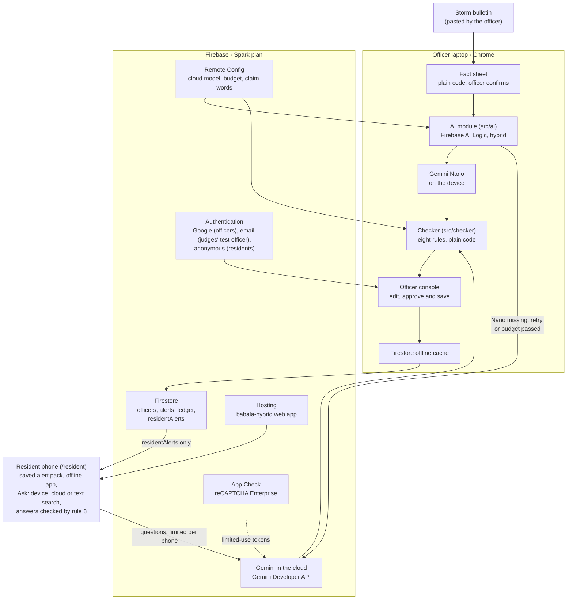

# Architecture

Babala turns an official storm bulletin into checked, plain-language typhoon alerts for each household, and keeps working when the signal drops. It is a static web app on Firebase with no server of its own, on the free Spark plan with no billing account.

A barangay officer's laptop drafts alerts with Gemini Nano on the device, through Firebase AI Logic. Plain code checks every figure against the bulletin, and the officer approves. The cloud model drafts when Nano is missing or fails, and translates approved alerts into Filipino and Cebuano while the connection is up. Residents' phones save the alerts and open them with no signal. They answer residents' questions on the device, in the cloud, or with plain text search when neither is available, and an AI answer is shown only after code checks it against the approved alert.

The SDK falls back to the cloud only when the local model is missing. Babala also catches a **bad** answer, with a code checker that no model can talk its way past.

The dashed line is App Check guarding the cloud calls. `src/ai/` is the only module that imports `firebase/ai`, and `src/checker/` imports no Firebase, AI or UI code.

## How one alert flows

1. **Sign in.** The officer signs in with Google; judges use the shared test officer account, with an email and password. The console opens only if their user ID has a document in the Firestore `officers` collection.
2. **Bulletin in.** The officer pastes the bulletin, or uses the demo bulletin. "Read bulletin" turns it into a fact sheet with plain code: storm name, signal number per area, landfall time and date, evacuation centres, puroks, barangays, hotline and any other figures. Facts it couldn't find are listed.
3. **Confirm.** The officer edits the facts and ticks "I checked every fact against the bulletin". Nothing is drafted before that, and editing a fact later cancels every approval.
4. **Draft.** The officer picks an area and drafts the four household alerts one after another. Each prompt gives the alert as three sentences built from the fact sheet. The model may reword them, and answers in JSON with one field per sentence. The text streams into the card, with a badge for the laptop or the cloud.
5. **Check.** The checker runs on the joined text. A failed draft is retried following the routing rules below, at most three AI calls in all. Problems are highlighted in the text, and the officer can edit any draft. It is re-checked on every keystroke, by code only.
6. **Approve and save.** "Approve and save" stays off until the alert passes. On approval the checker runs again on the exact text, and the alert is saved to `alerts/{household}__{areaKey}`, replacing the last one for that household and area. Its ledger entry is written in the same batch (step 9). Offline, the save waits in the Firestore cache on the laptop and uploads when the connection is back.
7. **Translate.** Under *Saved alerts and translations*, the officer asks the cloud ("only in cloud") to translate an active alert into Filipino, Cebuano or both, one call per language and click. The prompt names every figure and place name the translation must keep, taken from the English by the checker's own code. Each translation is checked on its own against the approved English alert (rule 7): the same figures and place names, no new places, and no Filipino or Cebuano claim word the English doesn't back. The officer can edit it or type one, re-checked on every keystroke, and "Approve and publish" checks the exact text again. Publishing adds it to the alert's resident copy with a `translated` ledger entry, in one batch. A new approval or a withdrawal clears the translations, so they never outlive the English they translate.
8. **Deliver.** The same batch that saves an approval writes the alert's resident copy at `residentAlerts/{id}`: the text, area, household, signal, storm name and time, and nothing else. Published translations are added to it later (step 7). Residents' phones read only these copies, keep the whole pack for offline use, and show each resident their alert (*Screens*).
9. **Keep the record.** Every approval writes a locked ledger entry with the alert: the confirmed fact sheet and bulletin, every model draft on that card since its last approval (which model, how long, the checker's verdict and each problem), any hand edit, the claim words the checker used, and who approved it when. Every published translation writes one too, with the English it was checked against, the cloud calls and checks behind it, and who published it when. The rules refuse an alert or translation without its entry, and nobody can change or delete an entry. The console's *Ledger* section traces each alert from the bulletin to the saved text, and each translation from the English to what residents read.
10. **Withdraw.** An officer can withdraw a saved alert from the console's *Saved alerts* section, with a reason. The alert keeps its text and approval, gains a `withdrawal` mark, and a `withdrawn` ledger entry records the text, the approval it withdraws and the reason, in the same batch. The resident copy loses its text in that batch too, so phones show "withdrawn" instead of the alert. The reason stays in the ledger only. Approving a new alert for the same household and area replaces the withdrawn one. Offline, the withdrawal waits on the laptop like a save.

## Components

| Component | Where | Role | Status |
| --- | --- | --- | --- |
| Officer console | `src/console/` | Bulletin, fact sheet, drafts, checks, approve and save, test log | Built |
| Officer sign-in | `src/officer/`, Firebase Authentication (Google, and email for the judges' test officer) | The console and drafting open only for officers | Built |
| Fact sheet | `src/factsheet/` | Demo bulletin to fact sheet in plain code. The officer's edit form | Built |
| AI module | `src/ai/`, Firebase AI Logic | Two draft models ("prefer on-device", "only in cloud"), streaming, device model download and warm-up | Built |
| On-device status | `src/ai/deviceStatus.ts` | Reads Chrome's `LanguageModel.availability()` for the UI only. Never prompts Nano directly | Built |
| Drafting | `src/drafting/` | Households, prompts, retry edits, JSON answer schema, routing | Built |
| Checker | `src/checker/` | Eight deterministic rules: 1 to 6 for drafts, 7 for translations, 8 for answers to residents' questions (`answer.ts`); issues with spans for highlighting | Built |
| Saved alerts | `src/alerts/`, Firestore `alerts` | One current approved alert per household and area | Built |
| Officer list | Firestore `officers` | Who may use the console. Edited only in the Firebase console | Built |
| Firestore rules | `firestore.rules`, `tests/rules/` | Officers only; exact fields and limits; server time and signed-in approver | Built and published |
| App Check | `src/firebase/index.ts`, `src/firebase/recaptchaRetry.ts`, reCAPTCHA Enterprise | Required by AI Logic; started before Firestore, so every Firestore request carries a token; reCAPTCHA reloaded when a page opened offline gets a signal | Built (enforced on AI Logic and Firestore, docs/firebase-setup.md section 4) |
| Remote Config | `src/firebase/remoteConfig.ts`, defaults in `src/config/defaults.ts` | Cloud model, on-device budget, claim words | Built |
| Setup status | `src/SetupStatus.tsx` | Shows whether Firebase, App Check and Remote Config work | Built |
| Resident copy | `src/alerts/residentCopy.ts`, Firestore `residentAlerts` | What residents read: each alert without officers' user IDs or the bulletin, written with every approval and withdrawal | Built |
| Resident view | `src/resident/` at `/resident` | Purok and household picker, the alert with its last update, a withdrawn notice, a language choice once translations exist, and Ask | Built |
| Ask | `src/ask/` (routes, prompt, text search, the run across routes), `src/resident/Ask.tsx`, `src/resident/useAsk.ts`, `createAskModels` in `src/ai/` | A resident's question answered on the device, in the cloud or by text search, each AI answer checked by rule 8 | Built |
| Offline pack | `src/resident/useResidentPack.ts`, `src/offline/` | The alert pack saved on the phone, and a service worker and manifest that keep the app itself there, so it opens with no signal and can be installed | Built |
| Translations | `src/translation/`, `src/console/Translations.tsx`, `src/console/useTranslations.ts`, on `residentAlerts` | Cloud-only translation into Filipino and Cebuano, each checked by rule 7 against the English, approved and published by an officer, with a ledger entry | Built |
| Ledger | `src/ledger/`, `src/console/Ledger.tsx`, Firestore `ledger` | A locked entry per approval, written with the alert: facts, drafts and checks with the model and time, edits, approver. A locked entry per withdrawal, with the reason, and per published translation | Built |
| Saved alerts | `src/console/SavedAlerts.tsx` | Every saved alert, active or withdrawn, and the place to withdraw one | Built |
| Hosting | `firebase.json`, `scripts/check-deploy-source.mjs`, `vite.secrets.ts` | Public URL for judges until Dec 16, deployed by Pim from the laptop | Built, live since Nov 13 |

## Screens

Two users share one web app: a barangay disaster officer on a laptop running Chrome, and residents on any phone browser. Every page shows the banner "Demo, not official guidance. The storm and barangay are fictional."

**Home, at `/`, built.** What Babala is in one line, an illustration of a resident's alert on bigger screens (no signal number, labelled "Demo"), the two ways in ("View alerts" for residents, "Open workspace" for officers), a three-step *How it works*, and an "Offline ready" pill once the service worker has saved the app. It loads no Firebase. Each view is its own chunk, loaded with `React.lazy` when it opens (`src/App.tsx`), so the home page stays small and phones never parse the officer console. Any other path shows *Page not found*.

**Officer console (laptop), at `/officer`, built.** One page, in this order:

- **Setup status.** Whether Firebase, App Check and Remote Config work, and which values are in use.
- **Officer sign-in.** "Sign in with Google", and a folded "Judges: sign in with the test officer account" form for the email and password in the testing instructions. A signed-in user who isn't on the list sees their user ID, to send to Pim. The test officer sees a note that the account is shared and that the ledger records what it does.
- **Models.** The on-device status, a "Prepare on-device model" button while Nano isn't downloaded, the warm-up time, and whether the cloud is online.
- **1. Bulletin.** Paste a bulletin, then "Read bulletin" or "Use the demo bulletin".
- **2. Fact sheet.** One field per fact, a list of facts not found, and "I checked every fact against the bulletin".
- **3. Draft, check and approve.** Area picker, "Draft all four", and one card per household. Each card has its own draft button, a streamed text with a source badge, highlighted problems and an editable text. It also shows "Use the cloud instead" after the budget (online only), "Approve and save", and the saved alert with its upload state and a "See its ledger entry" link. A withdrawn alert says so on its card, and "Approve and save" turns back on so the officer can replace it. "Copy test log" copies every prompt, answer and problem.
- **4. Saved alerts and translations.** Every saved alert in every area, by area and household, marked "Active" or "Withdrawn", and "Not uploaded yet" while offline. Each has a "See its ledger entry" link and, while active, "Withdraw", which asks for a reason (up to 300 characters, kept in the ledger only). An active alert also has a *Translations* box with Filipino and Cebuano side by side: "Published" or "Not published", what residents get now with its ledger entry, "Translate" (or "Translate again"), "Write it yourself" or "Edit", and "Translate into both". A translation shows whether the cloud wrote it or the officer typed or edited it, its problems highlighted, and "Approve and publish", which stays off until it passes. Translating needs a connection; publishing offline waits on the laptop. The section needs no bulletin, so an officer can act on an alert straight after opening the console.
- **5. Ledger.** The latest 50 approvals, withdrawals and translations, newest first. An approval is marked "Current alert", "Withdrawn" or "Replaced", a withdrawal "Still withdrawn" or "Replaced", a translation "Current translation", "Withdrawn" or "Replaced" (by a later translation or a new approval), and either "Not uploaded yet" while offline. Each opens into its trace. An approval shows the bulletin and confirmed facts, each draft with its model, time, verdict, problems and prompt, any hand edit, and the approval with who and when. A withdrawal shows the withdrawn text, a link to the approval it withdrew, and who withdrew it, when and why. A translation shows the English it translates with a link to that approval, each cloud call with its time, verdict, problems and prompt, any hand edit, and the published text with who and when.

**Resident view (phone), at `/resident`.** No sign-in screen: the phone signs in anonymously in the background. The home page and the officer page link to it.

1. **My alert** (built). The resident picks their purok and household type once, and the phone remembers both. They see their alert with the storm, signal and a "last updated" time. A withdrawn alert shows "The barangay withdrew the alert…" and no text. An area or household with no alert says so.
2. **Language** (built). A language choice appears on an alert that has a checked Filipino or Cebuano translation, and the phone remembers it. An alert without a translation into the chosen language shows English.
3. **Status line** (built). "Live" while connected, "Offline. Showing the alerts saved on this phone at …" with no signal, or what went wrong and what is still on screen.
4. **Offline** (built). The whole pack is saved on the phone each time the server sends it, and the service worker keeps the page itself, so it opens with no signal. Chrome offers "Install on this phone" where it can.
5. **Ask** (built). Under an active alert, "Ask about your alert": a question box (up to 200 characters), three example questions in the alert's language, and a line saying how the phone answers now (AI on this device, AI in the cloud, or text search) and how many cloud answers it has left this hour. The answer card shows its route as a badge, and then:
   - an AI answer that passed rule 8, with the alert sentences it cites quoted word for word, and a note that AI wrote it, code checked it, and the alert itself is what to follow;
   - "Your alert doesn't answer that" when the AI finds nothing, with the hotline sentence;
   - or the text search's sentences, word for word, or "Nothing in your alert matches" with the hotline sentence.

   Under it, a line for each route that didn't answer: too slow, an error ("busy right now, try again shortly" for a quota error), or an answer the check held back, with the check's reasons, never the answer itself. Questions aren't saved, and the box says that a cloud answer sends the question to Google's Gemini. A new alert or language starts an empty box.

## Routing: on-device, cloud or no AI

Short English jobs run on the device. Languages and long documents go to the cloud, and checking is always code. On the laptop a 3-sentence alert took 15.4 s, so on-device jobs stay at 3 sentences or fewer, stream as they're written, and get a 30 s budget before the console offers the cloud.

| Job | Where it runs | Why | Status |
| --- | --- | --- | --- |
| Turn the bulletin into a fact sheet | No AI for the demo bulletin format. Cloud for free-form bulletins when online, with every fact confirmed by the officer | Facts must be exact, and the officer stays in charge | Demo format built; cloud planned |
| Draft an English alert per household type | On-device first. The cloud if Nano is missing, after 2 failed checks, or after the 30 s budget | Private, free and works offline | Built |
| Check every draft and translation | No AI (code) | A model never vouches for itself | Built |
| Translate to Filipino and Cebuano | Cloud only, one call per language and click. Published on the resident copy, so phones keep it offline | Nano writes only English, German, Spanish, French and Japanese | Built |
| Summarise a long bulletin | Cloud | Too long for the laptop's model in time | Planned |
| Answer a resident's question | On-device if Nano is downloaded and the alert is read in English, cloud if online and the phone has cloud answers left, otherwise no-AI search of the saved alert. Every AI answer is checked by rule 8 | Always some answer, even with no signal | Built |

All AI calls go through Firebase AI Logic. Drafts use "prefer on-device" mode, translations use "only in cloud" (`createTranslationModel`, `translateOnce`), and residents' questions use "only on device" and "only in cloud" as two separate routes (`createAskModels`, `askOnce`). The app reads Chrome's model availability to show its offline state, but never prompts Nano directly.

What the SDK does (`firebase` 13.3.0), confirmed on day 1 with the hello-hybrid test:

- Every response says which model answered (`inferenceSource`: `on_device` or `in_cloud`). The badge, the test log and the saved alert's `source` read it.
- "Prefer on-device" uses Nano only when Chrome reports it fully downloaded; otherwise it silently uses the cloud. The download starts only from a click (`initializeDeviceModel()`), so the console has a "Prepare on-device model" button.
- The SDK falls back to the cloud only when Nano is unavailable at the start, not when an on-device call fails, so Babala catches that itself.
- The SDK can't cancel an on-device call. When the 30 s budget passes, the app stops waiting and makes a separate cloud-only call.

### Drafting and retries (`src/drafting/`, `src/console/useDrafts.ts`)

- **Two models** (`createDraftModels`): "prefer on-device" and "only in cloud", both with temperature 0.2. Both use the same JSON schema (`ALERT_SCHEMA`). Nano gets it through Chrome's response constraint (`onDeviceParams.promptOptions.responseConstraint`), and the cloud through `responseJsonSchema`. On-device input and output are declared as English text.
- **Warm-up.** The first on-device call after opening the page took 32.0 s on the laptop (first text at 26.1 s), almost all of it loading Nano. Warm drafts took 6.5 to 7.2 s. So when Chrome reports the model available, the console sends a one-word warm-up prompt, and drafts wait for it to finish.
- **The prompt** gives the alert itself as three sentences in the resident's voice:
  1. the signal and when the storm makes landfall;
  2. what to do and where to go;
  3. the hotline.

  A model that copies them word for word still writes a passing alert. Nano ignored "at most 3 sentences" and wrote 4 to 6, which is why the answer is JSON with one field per sentence (`signal_and_landfall`, `what_to_do_and_where_to_go`, optional `hotline`).
- **Retries** (`nextStep` in `route.ts`):
  - First, one draft with "prefer on-device".
  - If it fails, one retry on the device, unless the officer already moved to the cloud.
  - Then one call with "only in cloud" when online.
  - Then the officer edits by hand.
  - Offline with no on-device model, the officer writes the alert by hand.
- **The retry prompt** gives the failed draft back with one concrete edit per problem (`fixes.ts`): "Remove “today”", "Change “7 PM” to “6:00 PM”" or "Replace “[School Name]” with “Halimbawa Elementary School gym”".
  - When the shape is wrong (too long, a fact missing, the time on the wrong event), the model gets the outline again instead.
  - When the landfall time sits on the wrong event, the edit is word-level: "Change “Typhoon Sample is predicted to reach the area at 6:00 PM” to “Typhoon Sample makes landfall at 6:00 PM”".
  - After an error or an abandoned call, the next attempt starts from the plain prompt.
- **Budget.** If an on-device draft runs past `ondevice_budget_seconds`, the card offers "Use the cloud instead" while online. Offline it keeps waiting.
- **Test log.** "Copy test log" copies every prompt, raw answer, time and problem, so real on-device drafts can become test cases. It holds no secrets.

Results on the laptop, Nov 12: with JSON fields, Nano passed on its first draft for 3 of 4 households (about 15 s each). In round 5 it wrote all four, three on the first draft. The Families alert passed after the checker caught "safe" and Nano's retry removed it.

### Answering residents' questions (`src/ask/`, `src/resident/useAsk.ts`)

- **Routes** (`planAsk` in `route.ts`), at most one call each, so at most two AI calls per question and never two cloud calls:
  1. On the device, with "only on device", when Chrome reports Nano `available`, the alert is read in English and the question doesn't look Filipino or Cebuano (`looksLocal`: words like "saan", "asa", "ang"). Nano writes only English here, and its input is declared English. The resident view never starts a download, so phones without Nano never fetch it. When the resident first focuses the question box, a one-line on-device call loads Nano, since the first call on the laptop took 32 s. After `ondevice_budget_seconds` the phone stops waiting (the SDK can't cancel the call) and moves on.
  2. In the cloud, with "only in cloud", when online and the phone has cloud answers left (`ask_cloud_per_hour`, 6 by default, counted in the phone's local storage as `babala.ask.v1`). A cloud call is given up after 20 s.
  3. Text search, always available (`search.ts`): each sentence of the alert the resident reads is scored for the question's topics (where, when, signal, call, what to do; question words in English, Filipino and Cebuano) against what the sentence holds (a centre's name, a time, a signal number, a phone number, an instruction, read by the checker's own code), plus shared words. The best one or two sentences are quoted word for word, or none if nothing scores.
- **The prompt** (`prompt.ts`) numbers the alert's sentences in the language the resident reads, puts the question between `<question>` tags after removing angle brackets, control characters and line breaks and cutting it to 200 characters, and says not to follow instructions in it. Both routes answer in JSON (`ASK_SCHEMA`): `in_alert`, `sentences` (the numbers that answer it) and `answer`, at temperature 0.
- **The check.** An answer is shown only if rule 8 passes it against the approved English alert and the text the resident reads ([data-schema.md](data-schema.md), *Checker rules*). Otherwise the next route runs, and after the last one the text search. When the AI says the alert doesn't answer the question, no other route is asked.
- **Why this holds against prompt injection.** The question can only steer what the model writes, and code decides what is shown: no figure, place or claim the alert doesn't have, and few words of the model's own. An answer reaches only the person who asked, is never saved or shared, and sits under the approved alert with its sentences quoted. Known limit: the checker can't read meaning, so an answer made only of the alert's own words in a misleading order could pass; the quotes and the alert above it are the guard.

## The checker

No alert reaches a resident unless it passes every rule and an officer approves it. The checker is plain TypeScript, with no Firebase, AI or UI imports, and it never asks a model. The rules, what it reads and its known limits are in [data-schema.md](data-schema.md), *Checker rules*.

For drafts and translations it runs at three points:

1. on each model answer, to decide whether to retry;
2. on every keystroke while the officer edits;
3. again on the exact text inside `approvedAlert()` before anything is saved, so no path saves a failing alert, whatever the button state was.

The approval also refuses to save while the claim-word list hasn't loaded, because an empty list would let every added claim through.

On a resident's phone, rule 8 runs on every AI answer to a question, before it is shown. The phone has no fact sheet, so the approved alert is the source of truth there.

## Sign-in and access

- **Officers.** An officer is signed in with Google, and their Firebase user ID has a document in `officers`. Pim adds those documents by hand in the Firebase console, and the rules let nobody write them from the app. The console watches the user's own entry, so adding someone lets them in without a reload.
- **The judges' test officer.** One email and password account that Pim makes in the Firebase console and adds to `officers` like any officer. The rules accept a Google or an email and password sign-in, never anonymous or any other method, and being on the list is still what makes an officer: an email account that isn't on it gets nothing. The test officer can do what any officer can (draft, approve, withdraw, read alerts and the ledger) and nothing more, and the ledger records each action under its user ID. The email and password are only in the private testing instructions. Setup and recovery: [firebase-setup.md](firebase-setup.md), *Test officer for judges*.
- **Offline sign-in.** The persistent Firestore cache answers the officer check offline. A laptop that has never seen the list shows an offline message instead of "not an officer".
- **Firestore rules** (`firestore.rules`):
  - Officers may read alerts, and create or replace them with exactly the fields and limits the app writes.
  - `approvedBy` must be the signed-in user and `approvedAt` the server's time.
  - The area and its signal must be in the fact sheet saved with the alert.
  - Every alert write comes with a new ledger entry in the same batch that records it exactly, and an entry can't be written without its alert. Officers may read the ledger; nobody can change or delete an entry.
  - Withdrawing adds only a `withdrawal` mark (entry ID, the signed-in officer, the server's time) to an alert that has none, with a `withdrawn` entry in the same batch that names the alert's text and current approval. A withdrawn alert can only be replaced by a new approval.
  - Every approval and withdrawal also writes the resident copy, and a resident copy can only ever equal `residentCopy()` of its alert after the batch, so it never says anything the alert doesn't, and loses its text once the alert is withdrawn.
  - Publishing a translation changes only one language in `translations` on the copy of an active alert, with a new `translated` entry in the same batch that records that text against the alert's current text and approval. A copy rewritten on its own can't drop published translations; only a new approval or a withdrawal clears them.
  - Nobody can delete an alert, and everything else is denied.
  - Tested on the Firestore emulator (`npm run test:rules`, 176 cases, in CI). Each withdrawal check, the sign-in method check, and each resident-copy and translation check were broken on purpose to confirm a test catches them.
- **Residents** sign in anonymously, without a sign-in screen, and may read only `residentAlerts`: one copy at a time, or a list of at most 200. They can't read `alerts` (officers' user IDs, the bulletin) or the ledger, and can't write anything.
- **AI quota.** Drafting and translating are inside the officer console. Residents can use the cloud only for questions: one cloud call per question, at most `ask_cloud_per_hour` (6) per phone per hour, counted on the phone. That limit is a courtesy a determined visitor can clear with the site's storage; App Check (enforced on AI Logic, with limited-use tokens, and on Firestore) stops other clients, and AI Logic's own per-user quota (100 requests a minute by default) is the hard limit. On-device answers and the text search use no quota.

## Offline

- **Laptop (built).** Nano drafts with Wi-Fi off. The checker is plain code, so it runs offline too. Firestore's persistent cache (`persistentLocalCache` with a multi-tab manager) keeps the saved alerts, the ledger and the officer list. A save or a withdrawal made offline, alert and ledger entry together, waits on the laptop, and the card, the saved alerts and the ledger say it uploads when the laptop is back online. If another officer replaced the alert in the meantime, the withdrawal is refused on upload and the console says so. Publishing a translation offline waits the same way, and is refused on upload if the alert was replaced or withdrawn meanwhile. Making a translation needs the cloud, so the console says so offline and offers typing one. Remote Config keeps the last fetched values, or the defaults, when it can't fetch.
- **Phone (built).** Each pack the server sends is saved in the phone's local storage, and the page shows it first, before any network. A service worker (`src/offline/sw.js`, production builds only) keeps the page, its scripts and icons, so `/resident` opens with no signal, and the manifest makes the app installable. Pages load from the network when it answers within 3 s, so updates arrive, and from the phone otherwise. The worker never touches other sites (Firebase, Google sign-in) or anything but GETs. Each build gives it a new version, which replaces the old saved copy. Opened with no signal, the page can't load reCAPTCHA, so App Check has no token for Firestore; `src/firebase/recaptchaRetry.ts` loads it again once the signal is back, and the page goes live without a reload. Checked on an iPhone on the hosted site (Nov 13), from Safari and from the Home Screen; a Home Screen app on iOS has its own storage, so it needs one opening with a signal first. Questions work offline too: the text search is plain code in the saved app, and a laptop with Nano answers on the device.

## Configuration

- **Remote Config** holds the tunables, so changing them needs no redeploy. The defaults are in one file, `src/config/defaults.ts`:

  | Parameter | Default | Used for |
  | --- | --- | --- |
  | `cloud_model_name` | `gemini-3.5-flash-lite` | The cloud model for both draft models |
  | `ondevice_budget_seconds` | 30 | When to offer the cloud for a slow on-device draft |
  | `checker_claim_words` | JSON array built from the Nov 12 drafts | Checker rule 5 |
  | `checker_translation_claims` | JSON object of Filipino and Cebuano claim words, each with its English backing | Checker rules 7 and 8 |
  | `checker_answer_claims` | JSON array of phrases that tell a resident to do less than the alert ("stay home", "no need", "huwag lumikas") | Checker rule 8 |
  | `ask_cloud_per_hour` | 6 | Cloud answers to residents' questions per phone per hour; 0 turns them off |

  The app fetches at most once an hour (`REMOTE_CONFIG_MIN_FETCH_INTERVAL_MS`), the resident view included. An invalid value falls back to the default.
- **Firebase settings** come from Vite variables in `.env.local` (gitignored), listed in `.env.example`. Without them the page says what is missing, and the checker still works on text typed by hand.
- **Emulators.** With `VITE_FIREBASE_EMULATORS=true` in development, sign-in and saved alerts use the local Auth and Firestore emulators, with in-memory storage only. AI calls still use the real project.

## Trust controls (built)

- **All AI through Firebase AI Logic.** `firebase/ai` is imported only in `src/ai/index.ts`. There are no other model SDKs, and Nano is never prompted directly.
- **A model never vouches for itself.** Every alert passes the code checker before approval, and again when it is saved.
- **The officer approves** every alert, and the officer list is edited only in the Firebase console.
- **Residents never see officers' IDs or withdrawn alerts.** They read only the resident copy, which the rules hold equal to the alert minus approver, ledger and bulletin, and empty of text once withdrawn.
- **The saved record says who and what.** It includes which model wrote the text (`on_device`, `in_cloud`, `none` when typed, or `unknown`), whether the officer edited it, the approver's user ID (no name or email), the server time, and the confirmed fact sheet, so the alert can be re-checked later.
- **A locked ledger.** Every approval writes an entry with the drafts and checks behind it, in the same batch as the alert, every withdrawal writes one with its reason, and every published translation writes one with the English it was checked against. The rules refuse one without the other, and no one can change or delete an entry, so replacing or withdrawing an alert never erases its history.
- **Bounded AI use.** At most three AI calls per alert draft, and never a second cloud call. Translation is one cloud call per language per click, by a signed-in officer, with no automatic retry. A resident's question gets at most one on-device and one cloud call, within the phone's hourly cloud limit.
- **AI answers to residents are checked, not trusted.** Rule 8 holds every answer to the approved alert's figures, places, claims and words before it is shown, the alert sentences it rests on are quoted under it, and it says the barangay didn't write it. Questions are never saved.
- **Translations are checked and approved like alerts.** Each language is checked on its own against the approved English (rule 7) before an officer can publish it, and again on the exact text when it is published. Residents get a translation only on the copy of the current, active alert.
- **No secrets in the repo.** The Firebase config, reCAPTCHA key and App Check debug token live in `.env.local` and GitHub secrets. The App Check debug token is used only in development builds.
- **Fictional data** and the demo banner on every page.

## Testing and CI

- `npm run check`: typecheck, oxlint (warnings fail), Vitest and a production build. On Nov 13, with Ask: 30 test files, 465 tests.
- `npm run test:rules`: the Firestore rules on the emulator (Java 21).
- CI (`.github/workflows/ci.yml`) runs both on every pull request and on pushes to `main`. It never deploys.
- Gemini Nano can't run in CI or in a cloud session, so Pim tests on-device changes on the laptop before merging.

## Deployment

Firebase Hosting gives judges a public URL, `https://babala-hybrid.web.app`, that stays up until judging ends (Dec 16). Pim deploys from the laptop with `npm run deploy:hosting`, which deploys Hosting only and first checks that the laptop has `main` exactly as on GitHub and that `npm run check` passes. Nothing deploys from a pull request or from CI. The build takes its Firebase settings from the laptop's `.env.local`, and stops if the App Check debug token would end up in it (`vite.secrets.ts`).

`firebase.json` rewrites `/resident` and `/officer` to `/index.html`, serves `sw.js` from the root, and has phones check for a new page, service worker and manifest on every load, so a deploy reaches them at their next visit with a signal. Steps, headers and rollback: [firebase-setup.md](firebase-setup.md), *Hosting*.

## Cost plan (Spark plan, no billing account)

| Item | Approach |
| --- | --- |
| Firebase project | Spark plan with no billing account, so heavy use ends in quota errors rather than a bill. No Blaze upgrade, and no Google Account Quota sprint accounts |
| On-device drafts | Gemini Nano on the laptop: no AI Logic cloud call |
| Cloud model | Gemini Developer API backend through AI Logic, on the free tier. At most one cloud call per alert, and only signed-in officers can draft and translate. Residents' questions: at most one cloud call each, and 6 per phone per hour |
| App Check tokens | Each cloud call takes a limited-use App Check token, so residents' questions add reCAPTCHA assessments too. reCAPTCHA has a free monthly allowance far above the demo's use; check its usage in the Google Cloud console before judging |
| App Check | reCAPTCHA Enterprise provider, so others can't spend the project's quota |
| Firestore, Authentication, Remote Config, Hosting | Spark plan limits |
| CI | GitHub Actions on a public repository |
